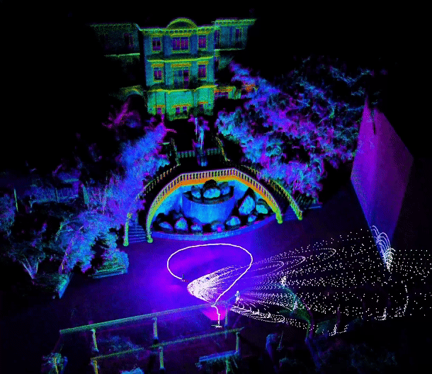
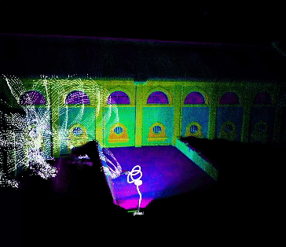
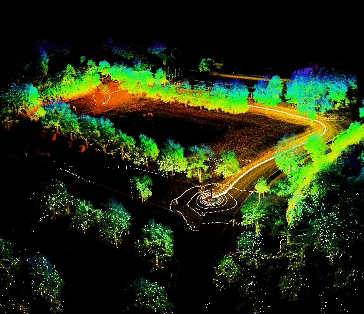
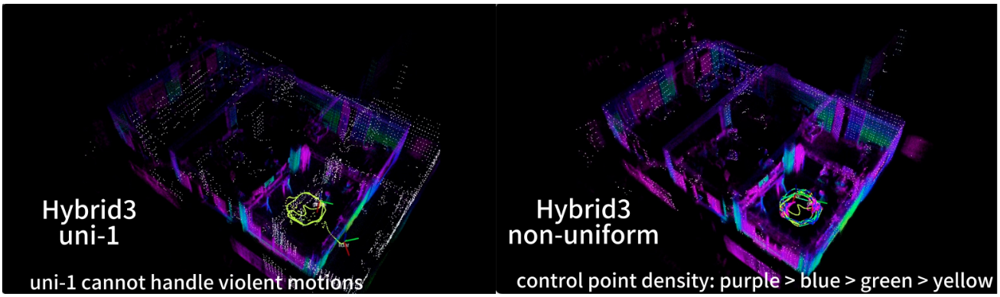
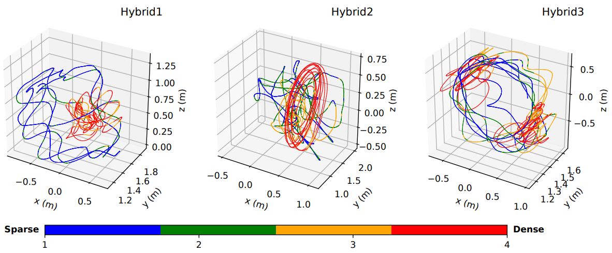
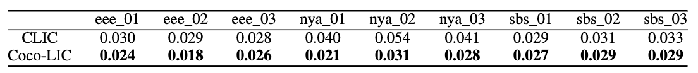

# Coco-LIC

**Coco-LIC: Continuous-Time Tightly-Coupled LiDAR-Inertial-Camera Odometry using Non-Uniform B-spline**

<p>



</p>

The following are three main characters of 🥥 Coco-LIC [[`Paper`](https://arxiv.org/pdf/2309.09808)] [[`Video`](https://www.youtube.com/watch?v=M-vlxK4DWno)] :

+ **dynamically** place control points to unlock the real power of the continuous-time trajectory
+ tightly fuse LiDAR-Inertial-Camera data in a **short sliding window** based on a factor graph
+ support **multimodal multiple** LiDARs and achieve great performance in **degenerated** cases 

## Prerequisites

+ ROS 2（tested to build with Jazzy）
+ Eigen 3
+ Ceres >= 2.0（the Ceres 2.2 shipped with Ubuntu 24.04 works）
+ glog
+ OpenCV 4
+ PCL >= 1.13
+ yaml-cpp

The Livox `CustomMsg` definition is included in this package, so [livox_ros_driver](https://github.com/Livox-SDK/livox_ros_driver) is not needed to replay bags.

## Install

Coco-LIC is the `cocolic` package of the [Gaussian-LIC](../README.md) repository. `--packages-select cocolic` builds it on its own, without the CUDA / LibTorch / TensorRT setup that Gaussian-LIC needs.

```shell
mkdir -p ~/ros2_gaussian/src
cd ~/ros2_gaussian/src
git clone https://github.com/APRIL-ZJU/Gaussian-LIC.git
cd ~/ros2_gaussian
source /opt/ros/$ROS_DISTRO/setup.bash
rosdep install --from-paths src --ignore-src -y
colcon build --symlink-install --packages-select cocolic
```

## Run

+ Download [R3LIVE dataset](https://github.com/ziv-lin/r3live_dataset) or [FAST-LIVO dataset](https://connecthkuhk-my.sharepoint.com/personal/zhengcr_connect_hku_hk/_layouts/15/onedrive.aspx?id=%2Fpersonal%2Fzhengcr%5Fconnect%5Fhku%5Fhk%2FDocuments%2FFAST%2DLIVO%2DDatasets&ga=1) or [NTU-VIRAL dataset](https://ntu-aris.github.io/ntu_viral_dataset/) or [LVI-SAM dataset](https://drive.google.com/drive/folders/1q2NZnsgNmezFemoxhHnrDnp1JV_bqrgV).

+ These datasets are ROS 1 bags, convert them to ROS 2 bags first, e.g. with [rosbags](https://gitlab.com/ternaris/rosbags) (>= 0.10).

  ```shell
  pip install rosbags
  rosbags-convert --src hku_park_00.bag --dst hku_park_00
  ```

  Coco-LIC reads ROS 2 bags directly: a bag directory, or a single `.mcap` / `.db3` file.

+ Modify `bag_path` in the `config/ct_odometry_xxx.yaml` file, or pass `bag_path:=...` to the launch file.

+ Run on R3LIVE dataset for example.

  ```shell
  cd ~/ros2_gaussian && source install/setup.bash
  ros2 launch cocolic odometry.launch.xml config_path:=config/ct_odometry_r3live.yaml bag_path:=/path/to/hku_park_00
  ```

  Add `rviz:=false` to run without rviz.

  The estimated IMU trajectory will be saved in the folder `~/ros2_gaussian/install/cocolic/share/cocolic/data`.

## Supplementary1 - non-uniform verification

1 control point per 0.1 seconds 🥊 adaptively placing control points per 0.1 seconds.

 

The different colors of the trajectory correspond to different densities of control points.

 

## Supplementary2 - comparison on NTU-VIRAL

We additionally compare Coco-LIC with our previous work [CLIC](https://github.com/APRIL-ZJU/clic) on NTU-VIRAL dataset, employing 1 LiDAR. 

The best results are marked in bold. It can be seen that Coco-LIC stably outperforms CLIC.

 

## Citation

If you find our work helpful, please consider citing 🌟:

```bibtex
@article{lang2023coco,
  title={Coco-LIC: continuous-time tightly-coupled LiDAR-inertial-camera odometry using non-uniform B-spline},
  author={Lang, Xiaolei and Chen, Chao and Tang, Kai and Ma, Yukai and Lv, Jiajun and Liu, Yong and Zuo, Xingxing},
  journal={IEEE Robotics and Automation Letters},
  year={2023},
  publisher={IEEE}
}
```
```bibtex
@article{lv2023continuous,
  title={Continuous-time fixed-lag smoothing for lidar-inertial-camera slam},
  author={Lv, Jiajun and Lang, Xiaolei and Xu, Jinhong and Wang, Mengmeng and Liu, Yong and Zuo, Xingxing},
  journal={IEEE/ASME Transactions on Mechatronics},
  year={2023},
  publisher={IEEE}
}
```

## Acknowledgement

Thanks for [Basalt](https://gitlab.com/VladyslavUsenko/basalt-headers), [LIO-SAM](https://github.com/TixiaoShan/LIO-SAM/tree/a246c960e3fca52b989abf888c8cf1fae25b7c25), [Open-VINS](https://github.com/rpng/open_vins), [VINS-Mono](https://github.com/HKUST-Aerial-Robotics/VINS-Mono), [R3LIVE](https://github.com/hku-mars/r3live) and [FAST-LIVO](https://github.com/hku-mars/FAST-LIVO).

## LICENSE

The code is released under the [GNU General Public License v3 (GPL-3)](https://www.gnu.org/licenses/gpl-3.0.txt).
